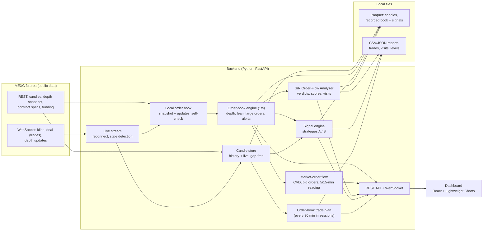

# MarketMind AI

**A local, free market-research and paper-trading assistant for crypto perpetual futures: support/resistance levels judged by live order-book and order-flow data.**

MarketMind AI connects to MEXC's public market data for **BTCUSDT.P** and **ETHUSDT.P** (USDT-margined perpetuals). It keeps a full live copy of the order book, follows every executed trade, and answers one question a discretionary trader cares about:

> *Price is at my support/resistance level. Are buyers or sellers winning there? Is this level more likely to **break** or to **hold**?*

It shows the answer on a TradingView-style dashboard, records how often it was right, and paper-trades its own signals so they can be judged on real results before anyone trusts them.

> ⚠️ **Research and paper trading only.** There is no code path that places real orders, and no API keys are used. Nothing here is financial advice. None of the strategies or signals in this repository has been shown to be profitable (see [Honest results so far](#honest-results-so-far)).

---

## Table of contents

- [Why this project exists](#why-this-project-exists)
- [What it does](#what-it-does)
- [How it works](#how-it-works)
- [The S/R Order-Flow Analyzer](#the-sr-order-flow-analyzer)
- [Paper-trading strategies](#paper-trading-strategies)
- [Research tools and backtests](#research-tools-and-backtests)
- [Honest results so far](#honest-results-so-far)
- [Tech stack](#tech-stack)
- [Getting started](#getting-started)
- [Using the dashboard](#using-the-dashboard)
- [Configuration](#configuration)
- [API](#api)
- [Data and output files](#data-and-output-files)
- [Testing](#testing)
- [Project layout](#project-layout)
- [Limitations](#limitations)
- [Roadmap](#roadmap)
- [Credits and licence](#credits-and-licence)

---

## Why this project exists

I trade support and resistance. The hard moment is always the same: price reaches the level, and I have to decide right then whether it will **break** (trade the breakout) or **turn back** (trade the reversal). Candles and indicators show what has already happened. The order book and the stream of executed trades show what is happening **now**: who is attacking the level, whether the orders defending it are being eaten or keep refilling, and whether price actually moves when aggressive orders hit it.

The goals:

1. **See the order flow at my levels** in plain words instead of raw numbers.
2. **Measure, don't guess.** Every signal is logged with what happened next, so its real hit rate can be compared with the base rate.
3. **Be honest about results.** Every strategy is tested with realistic costs and conservative fills, on data it was not tuned on. If it doesn't work, the project says so.
4. **Keep it free and local.** It runs on a normal Windows PC, uses only public data, and needs no paid services or API keys.

## What it does

| Area | What you get |
|---|---|
| **Live market data** | MEXC futures WebSocket: 1-minute candles, every executed trade, and order-book depth. Auto-reconnect and stale-feed detection. |
| **Local order book** | Full depth book rebuilt from a REST snapshot plus every live update, with version checks, crossed-book detection and a self-check against a fresh snapshot every 2 minutes. |
| **S/R Order-Flow Analyzer** | You add your own levels. When price is near one, it measures consumption, cancellation and replenishment of the defending orders, aggressive flow, CVD, price response and failed crosses, then says **LONG/SHORT — BREAKOUT/REVERSAL (STRONG)**, **GET READY**, **CONFLICTING**, **NO TRADE** or **INSUFFICIENT DATA**. |
| **Market-order panel** | Who is pushing over the last 5 and 15 minutes (buyers or sellers in control, absorption, weak moves), a CVD line, and a list of big market orders. |
| **Large-order tracking and alerts** | Large visible orders tracked over time (holding, growing, shrinking, absorbing, pulled, filled). Alerts only for the strongest bid and ask, and what happened to them. |
| **Paper strategies** | An order-book limit-order plan at strong daily/4H levels, and order-flow signal strategies A (market entry) and B (limit at the retest). $10,000 paper accounts, 1% risk, fees and slippage included. |
| **Dashboard** | White, TradingView-like chart (30m / 4H / 1D) with position boxes (green take-profit, light-red stop-loss, entry line), depth ladder, order-book lean, big orders, alerts, and all the panels above. |
| **Research scripts** | Historical download and validation, a conservative backtester, strategy comparisons, ML/deep-learning experiments, replay of recorded order-flow data, and scoring of the analyzer's track record. |

## How it works



Every second, the order-book engine reads the local book and the new trades for each coin, then passes them to the analyzer and the signal engine. Everything shown on the dashboard is pushed to the browser over a WebSocket once a second.

A few design rules run through the whole project:

- **No look-ahead.** Backtests act on the *next* bar after a signal; levels are built only from candles that had already closed; replays feed data one second at a time.
- **Conservative fills.** If a stop and a target are both touched in the same bar, the trade counts as a loss. Limit orders fill only if price trades *through* them (back of the queue). Gaps through a stop exit at the worse price.
- **Realistic costs.** MEXC futures fees (0% maker, 0.02% taker), 0.01% slippage, and funding where relevant.
- **Honest selection.** Data is split in time: settings are chosen on the earlier part (development) and judged once on the later, untouched part (test).

## The S/R Order-Flow Analyzer

This is the main tool. It uses **only the order book and executed trades, with no candles and no indicators**.

### Using it

1. Type the price of a level from your own chart (for example `81500`) into the analyzer panel and click **Add**. Add a few per coin, above and below the price.
2. When price comes within **1%** of a level, a card appears for it and updates every second.
3. When price comes within **0.1%**, a **visit** starts and is recorded with its outcome.

With no levels of your own, it watches the strong daily/4H levels instead (marked "auto").

### What it measures (every second, on the side defending the level)

At a **resistance** the defending side is the asks (sell orders) and the attackers are aggressive buyers; at a **support** it is the bids and aggressive sellers.

| Measure | Meaning |
|---|---|
| **Displayed vs executed** | Size resting within 0.1% / 0.25% of the level, and the size actually traded into it. Both are shown, because waiting orders are not the same as trades. |
| **Consumed** | Defending orders removed by trades. |
| **Cancelled** | Defending orders removed without trades (pulled). |
| **Replenished** | New defending orders, plus hidden refills (more traded than was removed, as with an iceberg). Cancels and re-posts are netted, because market makers move their quotes constantly. |
| **Attackers' share and CVD** | Aggressive volume toward the level vs away from it, from MEXC's trade feed (taker side). |
| **Price progress** | How far price moved toward or through the level. |
| **Price response** | Price movement per $1M of net aggressive volume, compared with that coin's normal over the last hour. Below 0.5× = absorbed; above 1.5× = moving easily. |
| **Liquidity persistence** | How much of the defending size is still at the *same* prices after 60 s. |
| **Flow persistence** | How many of the last 15 seconds the attackers held at least 60% of the flow. |
| **Failed cross** | Price traded 0.05% through the level, came back within 5 minutes, then the defenders took over the flow. |
| **Feed quality** | Book resynced in the last minute, trades arriving later than usual (allowing for a PC clock offset), trade stream silent, or too little activity → **INSUFFICIENT DATA**. |

### Scores and verdicts

Two independent scores from 0 to 100 (they do not have to add up to 100):

- **Breakout** = 30 attack + 30 defending liquidity giving way + 25 price moving through + 15 attack persistence
- **Reversal** = 30 attack + 30 defending liquidity holding + 25 price failing or absorbed + 15 attack persistence

| Label | When |
|---|---|
| 🟢/🔴 **LONG / SHORT — BREAKOUT (STRONG)** | Breakout score ≥ 75, reversal < 60, price within 0.1% of the level, price moving through, attack held. |
| 🟢/🔴 **LONG / SHORT — REVERSAL (STRONG)** | Reversal score ≥ 75, breakout < 60, price within 0.1%, not moving through, and either attackers really trading into the level while it is absorbed, or a failed cross. |
| **GET READY: possible …** | A score of 60–74, or a high score while price is not at the level yet. |
| 🟠 **CONFLICTING** | Both scores ≥ 60. |
| ⚪ **NO TRADE — wait** | Both scores below 60. |
| ⚠️ **INSUFFICIENT DATA** | The feed-quality gate failed. |

Direction: a breakout at resistance or a bounce at support is **LONG**; a breakdown at support or a rejection at resistance is **SHORT**.

A simpler **baseline** rule set (no scores) runs alongside and is shown underneath each card for comparison.

### Track record

For every visit, the analyzer records the first signal of each version, and the outcome is decided **without candles**: did price go **0.3% through** the level first (*broke*), **0.3% back** first (*held*), or neither within **60 minutes** (*unresolved*)? The panel shows each version's hit rate next to the base rate.

- Overlapping visits (another visit on the same coin already running) are excluded, so one price move is not counted twice.
- Unresolved visits stay in and count as wrong calls.
- A signal is only useful if it is right clearly more often than the base rate.

`python -m scripts.score_sr_analyzer` re-scores all recorded visits from their saved per-second data. It uses the first 70% of visits for development and the last 30% as an untouched test, and compares the baseline, the full scored version, and the scored version with **one filter switched off at a time** (an ablation test), to show which filters actually help.

## Paper-trading strategies

All paper accounts start at $10,000 and risk 1% per trade, with fees and slippage. Nothing is sent to the exchange.

### 1. Order-book limit-order plan (strong daily/4H levels)

Every 30 minutes during the Asia, London and New York sessions:

1. **Strong levels** come from daily and 4-hour swing highs and lows only. A daily turn counts 3 and a 4H turn counts 1; levels within 0.4% are merged; at most 3 above and 3 below price, at least 0.8% apart.
2. It looks in the live book for the **strongest wall** sitting on one of those levels (at least 4× a normal bucket).
3. If found, it places a **paper limit order** in front of the wall: long at support with the target at the next resistance and the stop beyond the next support, or the mirror image for shorts. Reward:risk must be at least 1.2.

A pending order is cancelled if the wall is pulled (shrinks below 40%), if price reaches the target first, or after 12 hours. The chart draws it like TradingView's position tool.

### 2. Order-flow signals: strategies A and B

At a strong level, after price touches it, each completed 5-minute close classifies the situation as **bounce, breakdown, rejection, breakout** or **uncertain**. The setup is then checked for a defending wall (or its absence for breaks, and whether it was absorbed, consumed or pulled), order-book imbalance in two ranges, aggressive flow, CVD, and reward:risk ≥ 1.5 after costs. Every check is logged, passed or not.

- **A:** enters at market immediately (taker fee + slippage).
- **B:** places a limit at the retest. It fills only if price trades through it; otherwise it counts as **missed**.

Results are reported overall and by setup type. Every touch of a level is also saved as a labelled **level test** (broke / held / unresolved, with CVD, flow, imbalance and wall fate at the touch), and `python -m scripts.replay_signals` replays the recorded one-second inputs through the same engine.

## Research tools and backtests

The project started with a broad search for any edge, tested the same honest way.

| Experiment | What was tested | Script |
|---|---|---|
| **Baseline setups** | 3 trade lengths (1m / 15m / 1h) × pullback and breakout setups × 3 targets × BTC/ETH (36 combinations) | `compare_strategies` |
| **New York opening-range breakout (ORB)** | 9:30–9:45 ET range, several entries, stops and targets (96 combinations on 5m/15m) | `compare_orb` |
| **ORB + ML filter** | Gradient-boosted model with 20 features to skip weak breakouts; cut-off chosen on out-of-fold predictions | `orb_ml` |
| **ORB with a fixed stop/target** | BTC ±1,000 / ETH ±100, held to 9:29 ET the next day, every day including weekends | `compare_orb_fixed` |
| **ML + deep-learning direction models** | Gradient-boosted trees and an LSTM on 30m/4H/1D features, with a confidence threshold, compared with always-long, always-short and random | `direction_ml` |
| **Live terminal paper trader** | Runs the direction models live at New York session candle closes | `live_trader` |

**Pass/fail rule:** a strategy is eligible only with at least 30 development and 10 test trades, a profit after costs in **both** periods, and a development result at least 2 standard errors above zero. The selection code was checked on synthetic data: on pure random data it picks nothing, and on data with a planted pattern it finds that pattern.

## Honest results so far

- **None of the candle-based strategies, ORB variants or ML/DL direction models passed the test.** After realistic costs, on unseen data, none of them showed a reliable edge on BTC or ETH.
- The order-book and order-flow tools **cannot be backtested on past data from this project**, because order-book history only exists from the moment you start recording. They are judged on recorded live data and paper results.
- All thresholds and score weights in the analyzer and signal engines are **starting guesses, not tuned values**. Treat every signal as a second opinion until the track record shows it beats the base rate on enough independent visits (50+).

This is published as an honest research tool, not as a money-making system.

## Tech stack

**Backend**
- **Python 3.11+** (tested on 3.11 and 3.13)
- **FastAPI** + **Uvicorn** for the REST API, the WebSocket and serving the built dashboard
- **httpx** (REST) and **websockets** (live stream)
- **pandas**, **NumPy**, **PyArrow** for data and Parquet storage
- **pydantic-settings** for configuration (`.env`, `MM_` prefix)
- **scikit-learn** (gradient-boosted trees) and **PyTorch** (LSTM) for the ML/DL experiments
- **pytest** + **pytest-asyncio**: 212 automated tests

**Frontend**
- **React 19** + **Vite 8**
- **TradingView Lightweight Charts 5** with a custom series primitive for the position boxes
- Plain CSS with light-theme design tokens

**Data source**
- **MEXC futures public API** (REST `contract.mexc.com`, WebSocket `wss://contract.mexc.com/edge`). No account or API key needed.

## Getting started

### Requirements

- Windows, macOS or Linux
- **Python 3.11 or newer** ([python.org](https://www.python.org/downloads/); on Windows tick "Add Python to PATH")
- Internet access to MEXC
- Node.js 22+ **only** if you want to change the dashboard (a built copy is included)

### Install (Windows PowerShell)

```powershell
git clone https://github.com/<your-username>/marketmind-ai.git
cd marketmind-ai\backend
python -m venv .venv
.venv\Scripts\activate
pip install -r requirements.txt
```

If PowerShell blocks `activate`, run `Set-ExecutionPolicy -Scope CurrentUser RemoteSigned` once and try again. On macOS or Linux, use `source .venv/bin/activate`.

Optional: copy `.env.example` to `.env` (in the `marketmind-ai` folder) to change settings.

### Run

```powershell
cd backend
.venv\Scripts\activate
uvicorn app.main:app
```

Open **http://127.0.0.1:8000**. The first start downloads the 30m, 4H and daily history it needs, which takes about a minute. Stop the server with Ctrl+C.

### Useful scripts (run from `backend/` with the environment active)

```powershell
python -m scripts.download_history                 # 30 days of 1m candles (add --days / --interval)
python -m scripts.stream_live                      # live feed in the terminal
python -m scripts.check_orderbook                  # order-book feed check, ends with RESULT: OK
python -m scripts.compare_strategies               # baseline strategy comparison
python -m scripts.compare_orb                      # New York opening-range breakout
python -m scripts.compare_orb_fixed                # ORB with fixed stop/target
python -m scripts.orb_ml                           # ORB + ML filter
python -m scripts.direction_ml                     # ML / deep-learning direction models
python -m scripts.live_trader                      # terminal paper trader for the direction models
python -m scripts.replay_signals [--grid]          # replay recorded order-flow data (after ~2 weeks)
python -m scripts.score_sr_analyzer [--grid]       # score the analyzer's recorded visits
```

### Working on the dashboard

```powershell
cd frontend
npm install
npm run dev        # http://localhost:5173, with the backend running
npm run build      # update frontend/dist, which the backend serves
```

## Using the dashboard

- **Top:** BTC / ETH tabs with live prices, and timeframe buttons (30m, 4H, 1D).
- **Chart:** candles and volume in your local time, plus the current paper plan drawn as TradingView-style position boxes.
- **Right side, top to bottom:**
  - **S/R order-flow analyzer:** your levels, a live card per nearby level, and the track record.
  - **Order-book trade plan:** where the paper limit order is and why.
  - **Order-flow signals (A/B):** live checklist, results by setup type, level tests.
  - **Market orders: who is pushing?:** 5/15-minute reading, CVD line, big market orders.
  - **Feed health, order-book lean, depth ladder, large visible orders.**
- **Bottom:** alerts for the strongest bid and ask and what happened to them.

The New York session runs from 9:30 to 16:00 New York time. In the analyzer, a STRONG signal should be read together with your own levels and judgement. It is not an instruction to trade.

## Configuration

Settings come from environment variables or a `.env` file in the project root, all with the `MM_` prefix. Examples:

| Variable | Default | Meaning |
|---|---|---|
| `MM_SYMBOLS` | `["BTCUSDT.P","ETHUSDT.P"]` | Symbols to follow |
| `MM_LIVE_STREAM_ENABLED` | `true` | Connect to the live WebSocket |
| `MM_STALE_AFTER_SECONDS` | `10` | Mark the feed stale after this long without data |
| `MM_ORDERBOOK_REFRESH_SECONDS` | `120` | Self-check the book against a fresh snapshot |
| `MM_ORDERBOOK_RECORD` | `true` | Record the book, signal inputs and visit data to `data/` |
| `MM_LOG_LEVEL` | `INFO` | Logging level |

Strategy and analyzer thresholds live in code, each documented where it is defined:

| File | Contents |
|---|---|
| `backend/app/sranalyzer/measure.py` | `AnalyzerRules`: baseline analyzer thresholds, visit and outcome distances |
| `backend/app/sranalyzer/scoring.py` | `ScoreRules`: score weights, STRONG/LEAN levels, feed-quality gate, failed cross |
| `backend/app/signals/rules.py` | Signal engine A/B: level distance, wall, imbalance, flow, risk, costs |
| `backend/app/obtrade/levels.py` | How strong daily/4H levels are found |
| `backend/app/orderbook/alerts.py` | `MIN_WALL`: minimum size for strongest-order alerts |
| `backend/app/orderflow/flow.py` | Big-market-order size and the 5/15-minute reading |

## API

Interactive documentation: **http://127.0.0.1:8000/docs** while the server is running. Main endpoints:

| Endpoint | Purpose |
|---|---|
| `GET /health` | Server health |
| `GET /api/market/symbols`, `/candles/{symbol}`, `/quality/{symbol}`, `/live/{symbol}`, `/status` | Market data, data-quality report, live state |
| `GET /api/dashboard/chart/{symbol}?interval=4h` | Chart bars (30m, 4h, 1d) |
| `GET /api/dashboard/orderbook/{symbol}` | Order-book view |
| `GET / POST / DELETE /api/levels/{symbol}` | List, add (`{"price": 81500}`) or remove (`?price=`) your analyzer levels |
| `WS /ws/live/{symbol}?interval=4h` | Everything the dashboard shows, once a second |

## Data and output files

Everything stays on your machine. Market data and reports are **not committed** to git (see `.gitignore`).

| Path | Contents |
|---|---|
| `data/raw/mexc_futures/<SYMBOL>/<interval>.parquet` | Historical candles, with a JSON validation report alongside |
| `data/orderbook/…` | Recorded order book, 1 snapshot/second (about 25–40 MB per symbol per day) |
| `data/signals/…` | One-second inputs of the signal engine, for replay |
| `data/sr_analyzer/…` | Per-second data of every analyzer visit, for re-scoring |
| `reports/my_levels.json` | Your analyzer levels |
| `reports/sr_visits.csv` | Every analyzer visit: signals of both versions, scores, failed cross, overlap, outcome |
| `reports/signal_evaluations.csv`, `signal_trades.csv`, `level_tests.csv` | Signal engine checks, paper trades, level tests |
| `reports/ob_trades.csv`, `ob_plan_state.json` | Order-book plan trades and state |
| `reports/*.md` | Reports written by the research scripts |
| `models/` | Trained ML/DL models |

## Testing

```powershell
cd backend
python -m pytest
```

212 tests cover:
- the MEXC adapter (mocked), pagination, data validation and incremental history;
- the live stream, including a real local WebSocket server with dropped connections and reconnects;
- order-book syncing (gaps, duplicates, crossed books), depth and lean figures, large-order tracking and alerts;
- the candle store and timeframe conversion;
- the backtester (look-ahead, conservative fills) and the ORB and direction-model pipelines;
- the signal engine (all four setup types, wall fate, level tests, replay with no look-ahead);
- the S/R analyzer (consumed / cancelled / replenished maths, quote churn, verdicts, failed cross, feed-quality gate including PC clock offset, overlapping visits, scoring and ablation);
- the API endpoints.

## Project layout

```
marketmind-ai/
├── backend/
│   ├── app/
│   │   ├── main.py              FastAPI app: starts the stream, engines and dashboard
│   │   ├── config.py            settings (.env, MM_ prefix)
│   │   ├── adapters/            exchange interface + MEXC futures REST adapter
│   │   ├── data/                history download, validation, live WebSocket, candle store
│   │   ├── orderbook/           local book, depth/lean features, large orders, alerts, recorder
│   │   ├── orderflow/           market orders: CVD, big orders, 5/15-min reading
│   │   ├── sranalyzer/          S/R Order-Flow Analyzer (measure, scoring, analyzer)
│   │   ├── signals/             signal engine A/B, paper simulator, row recorder
│   │   ├── obtrade/             strong daily/4H levels + order-book limit-order plan
│   │   ├── backtest/            conservative bar-by-bar backtester and metrics
│   │   ├── strategy/            baseline setups, ORB rules and features
│   │   ├── ml/, direction/      ML filter and ML/deep-learning direction models
│   │   └── api/                 market and dashboard routes, levels API, WebSocket
│   ├── scripts/                 command-line tools (download, checks, backtests, replay, scoring)
│   ├── tests/                   212 pytest tests
│   └── requirements.txt
├── frontend/
│   ├── src/                     React app (chart, panels, analyzer, signals)
│   └── dist/                    built dashboard served by the backend
├── data/  models/  reports/     local data and outputs (not committed)
├── .env.example
└── README.md
```

## Limitations

- **Visible orders are not intentions.** Orders can be cancelled at any time, hidden (iceberg) size is only partly detectable, and the book shows displayed liquidity, not everyone's plans.
- **Limited depth.** MEXC's snapshot covers roughly ±0.6% around BTC's price, so levels further away cannot be checked against the book.
- **No order-book history before you start recording.** The order-flow tools must be judged forward, on your own recordings and paper trades. [Tardis.dev](https://docs.tardis.dev/historical-data-details/mexc-futures) has MEXC futures book data since June 2026 (the first day of each month is free), which could allow an offline retest in future.
- **Unproven settings.** Thresholds and weights are starting guesses. More filters can also mean more overfitting; that is why the baseline and ablation comparisons exist.
- **One exchange, two coins.** Only MEXC BTC and ETH perpetuals.
- **A local tool.** It is built for one person on one PC, with no authentication. Do not expose the server to the internet.

## Roadmap

- Paper strategies driven by the analyzer's STRONG breakout/reversal verdicts, with the same risk and costs as the others.
- A "minute 29" check: save the verdict just before each New York 30-minute candle closes at a level, to test that exact trading routine.
- Sound and browser notifications for STRONG signals.
- Price bands for the liquidity-persistence measure, so quotes nudged by one tick still count as the same liquidity.
- An offline retest on Tardis.dev MEXC order-book data.

## Credits and licence

- Charts by [TradingView Lightweight Charts](https://github.com/tradingview/lightweight-charts) (Apache 2.0). Its licence requires the small TradingView logo in the chart corner.
- Market data: MEXC public API.
- Built with the help of Claude (Anthropic) as an AI pair-programmer.

**Licence:** not chosen yet. Add a `LICENSE` file before publishing if you want others to be able to reuse the code (MIT is a common choice for projects like this).

**Disclaimer:** this software is for education and research. Trading crypto futures carries a high risk of loss. The author and contributors accept no responsibility for any trading decisions or losses.
